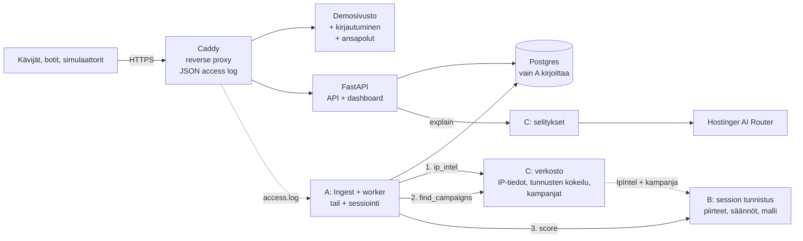
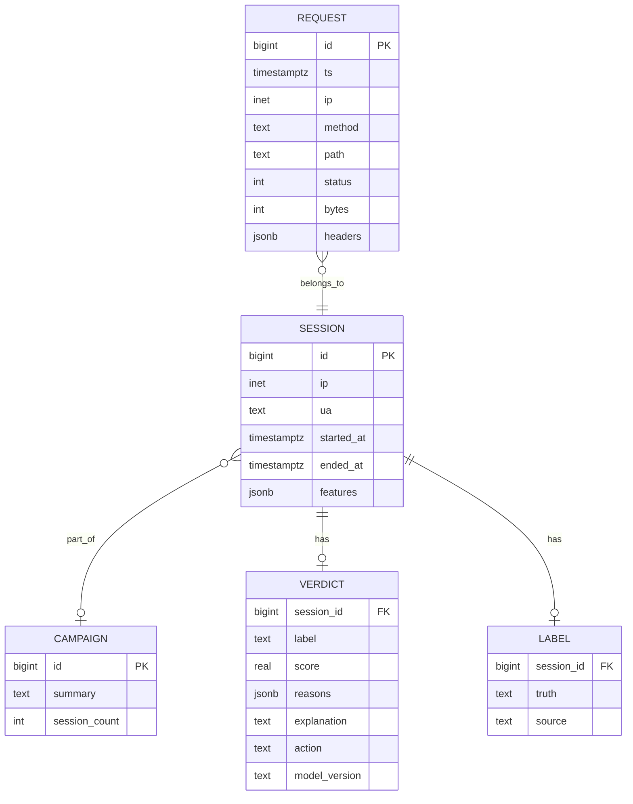

# Architecture

> Alustava suunnitelma. Päivitetään heti kun komponentit ovat olemassa.

## Runtime shape

Kaikki pyörii yhdellä Hostinger KVM 2 -VPS:llä (2 vCPU, 8 GB) Docker Composella.

A omistaa *missä ja milloin* koodi ajetaan, B ja C omistavat *mitä* lasketaan (puhtaita funktioita ilman tietokantaa).

## Components

| Component | Path | Owner | Responsibility |
|---|---|---|---|
| Proxy + demosivusto | `deploy/`, `src/site/` | A | Caddy, TLS, JSON-loki, rate limit, kirjautumislomake, ansapolut |
| Ingest + worker | `src/bouncer/ingest/` | A | Tail, parsinta, sessiointi, `X-Sim-Run` → `labels`, kutsuu C:n ja B:n funktioita |
| Tietokanta + sopimukset | `src/bouncer/db/`, `contracts.py`, `samples/` | A | Skeema, `load_sessions()`, jaetut tietotyypit |
| Simulaattorit (hyökkääjä) | `tools/sim/` | A | Scraper, skanneri, hidas skanneri, hajautettu tunnusten kokeilu, Playwright-"ihminen", piilotettu hyökkäys |
| API + dashboard | `src/bouncer/api/`, `src/bouncer/web/` | A | Ohut API, dashboard, `/metrics`-sivu |
| Session tunnistus | `src/bouncer/session/`, `models/` | B | Piirteet, säännöt, malli, kynnykset, lopullinen `score()` |
| Arviointi | `src/bouncer/eval/` | B | Datasetti, train/test-jako, ablaatio → `metrics.json` |
| Verkostotunnistus | `src/bouncer/network/` | C | `ip_intel()`, tunnusten kokeilu sessioiden yli, `find_campaigns()`, `campaign_metrics.json` |
| Selitykset | `src/bouncer/explain/` | C | `explain()` AI Routerin kautta + varateksti |

Tarkka omistajuus, taulut ja sopimukset S1–S11: `TEAM.md`.

Stack: Python 3.12, FastAPI, Postgres 16, scikit-learn / LightGBM, Jinja + HTMX (ei SPA:ta), Caddy, Docker Compose.

## Detection design

### 1. Sessio

Pyynnöt ryhmitellään avaimella `(IP, User-Agent)`; sessio katkeaa 5 min hiljaisuuden jälkeen. Kaikki pisteytys tehdään sessiotasolla, ei yksittäisillä pyynnöillä.

### 2. Piirteet (jokainen selitettävissä yhdellä lauseella)

Session piirteet (B) lasketaan yhdestä sessiosta. Verkostopiirteet (C) — IP-tiedot, tunnusten kokeilu sessioiden yli, kampanjajäsenyys — tulevat B:n `score()`-funktiolle valmiina syötteinä.

| Ryhmä | Piirteet |
|---|---|
| Tahti | pyyntöä/min, pyyntöjen välisten aikojen variaatiokerroin (botit liian tasaisia), session kesto |
| Sisältö | staattisten resurssien (CSS/JS/kuvat) osuus, HTML-sivujen osuus, polkujen monipuolisuus, `robots.txt` haettu |
| Virheet | 4xx-osuus, 404-osuus, tunnettujen haavoittuvuuspolkujen osumat (`/.env`, `/wp-login.php`, `/.git/`) |
| Kirjautuminen | epäonnistuneet POST /login, eri käyttäjätunnusten määrä per IP, sama tunnus monesta IP:stä |
| Otsakkeet | UA vs. otsakkeiden johdonmukaisuus (Chrome-UA ilman `Accept-Language` / `Sec-Fetch-*`), puuttuva Referer sisäsivuilla |
| Verkko | datakeskus-ASN vs. kotiliittymä (offline-ASN-lista), maa |
| Ansat | piilolinkin tai `/wp-admin`-ansan osuma |

### 3. Pisteytys kolmessa kerroksessa

1. **Varmat säännöt** — ansaosuma ⇒ haitallinen; käänteisellä DNS:llä varmistettu Googlebot/Bingbot ⇒ hyvä botti. Näistä tulee myös osa oikeista vastauksista.
2. **Malli** — gradient boosting / logistinen regressio piirteiden päällä. Jokaiselle päätökselle 3 eniten painanutta piirrettä (SHAP tai kertoimet).
3. **Kynnykset ja epävarma-vyöhyke** — kaksi kynnystä: alle ⇒ ihminen, yli ⇒ botti, välissä ⇒ *epävarma*. Botti-kynnys valitaan niin, että ihmisten FPR testijoukolla < 1 %.

LLM **ei tee päätöstä**. Se saa valmiin tuloksen + piirteet ja kirjoittaa selityksen ja suositellun toimenpiteen.

### 4. Kampanjat (swarm) — kaista C

Tunnusten kokeilu sessioiden yli: sama käyttäjätunnus monesta IP:stä, hajautetut epäonnistuneet kirjautumiset, hidas tahti. Tunnettu väärien positiivisten lähde: jaettu IP (toimisto, venue-WiFi, mobiili-NAT), jossa monta ihmistä näyttää yhdeltä toimijalta.

Sessiot, joilla on sama otsakesormenjälki + samankaltainen polkujärjestys (MinHash/Jaccard) + aikaikkunoiden päällekkäisyys, klusteroidaan (DBSCAN tai yksinkertainen union-find kynnyksellä). Tulos: "kampanja X: 37 IP:tä, 3 ASN:ää, sama polkujärjestys, alkoi 14:02".

### 5. Oikeat vastaukset ja arviointi

| Lähde | Label | Luotettavuus |
|---|---|---|
| Ansaosumat | haitallinen | erittäin korkea |
| Varmistetut hakukonebotit | hyvä botti | erittäin korkea |
| Omat hyökkäysskriptit (tunnetut IP:t/UA-merkit) | haitallinen + alaluokka | korkea, mutta liian "helppo" |
| Playwright-"ihmiset" | ihminen (simuloitu) | keskitaso |
| Oikeat ihmiset (QR-koodi, tiimi, kaverit) | ihminen | korkea, vähän dataa |

Rehellisyyssäännöt:
- **Temporaalinen jako**: opetus ennen ajanhetkeä T, testi sen jälkeen.
- **Hyökkääjä ≠ puolustaja**: simulaattorit kirjoittaa A, tunnistimet B ja C.
- **Piilotettu hyökkäys**: A kirjoittaa yhden hyökkäyksen, jota B ja C eivät näe ennen T+34; tulos raportoidaan sellaisenaan ilman uudelleenopetusta.
- **Ablaatio**: B raportoi tuloksen myös ilman C:n verkostosignaaleja.
- **Kampanjoiden totuus**: `X-Sim-Run` sisältää kampanja-id:n → C mittaa klusteroinnin puhtauden ja kattavuuden.
- Metriikat raportoidaan **erikseen** simuloidulle ja oikealle liikenteelle.
- Ansaosumia käytetään labeleina, joten ansapiirre **poistetaan** mallin syötteistä arvioinnissa (muuten malli "huijaa").

## Data model

## API (alustava)

| Method | Path | Mitä |
|---|---|---|
| GET | `/api/sessions?label=&since=` | Sessiot tuloksineen |
| GET | `/api/sessions/{id}` | Yksi sessio: pyynnöt, piirteet, syyt, LLM-selitys |
| GET | `/api/campaigns` | Kampanjat |
| POST | `/api/analyze` | Lataa access-loki (nginx/Apache combined tai JSON) → raportti |
| GET | `/api/metrics` | Arvioinnin luvut JSONina |
| GET | `/metrics` | Sama ihmisille luettavana |
| GET | `/healthz` | Terveys |

## Environments

| Env | URL | Data | Notes |
|---|---|---|---|
| Local | http://localhost:8000 | Docker Postgres + tallennettu lokinäyte | `make up && make dev` |
| Demo | Hostinger VPS + ilmainen domain | Oikea liikenne + simulaattorit | Julki mahdollisimman aikaisin |

## Failure modes

- AI Router ei vastaa → näytetään sääntöpohjainen selitys (malli toimii ilman LLM:ää).
- Ingest jää jälkeen → dashboard näyttää viimeisimmän käsitellyn ajanhetken.
- VPS kaatuu → seed-data paikallisesti + varavideo.
