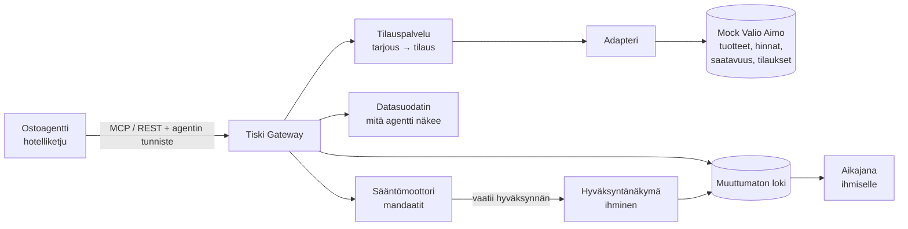
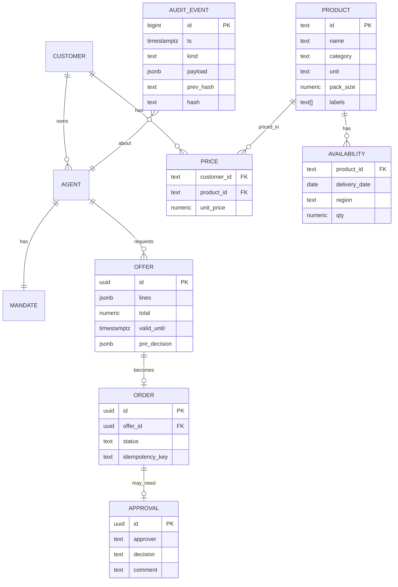

# Architecture

> Alustava suunnitelma. Päivitetään heti kun komponentit ovat olemassa.

## Runtime shape



Kaistat (ks. `TEAM.md`): **A** = mock-järjestelmä + tilauspalvelu, **B** = gateway + säännöt + turva, **C** = ostoagentti + ihmisen näkymät + pitch.

## Components

| Component | Path | Owner | Responsibility |
|---|---|---|---|
| Mock Valio Aimo | `src/tiski/backend` | A | Tuotteet, asiakaskohtaiset hinnastot, saatavuus per toimituspäivä, tilaukset, seed-data |
| Adapteri | `src/tiski/backend/adapter.py` | A | Yksi rajapinta backendiin → voidaan vaihtaa Valion omaan mockiin |
| Tilauspalvelu | `src/tiski/orders` | A | Tarjouksen luonti (kiinteä hinta, voimassaolo), tilaus tarjouksesta, idempotenssi, tilat |
| Gateway (MCP + REST) | `src/tiski/gateway` | B | Työkalut/endpointit, agentin tunnistus, rate limit, OpenAPI-skeema |
| Sääntömoottori | `src/tiski/policy` | B | Mandaatit tiedostoina, päätös + syyt, ei LLM:ää |
| Datasuodatin | `src/tiski/policy/exposure.py` | B | Mitä kentät agentti saa nähdä |
| Loki | `src/tiski/audit` | B | Append-only, hash-ketju, aikajana-API |
| Ostoagentti | `agents/buyer` | C | LLM-agentti MCP:n päällä, demon "asiakas" |
| Ihmisen näkymät | `src/tiski/web` | C | Hyväksyntä (mobiili), aikajana, mandaatin muokkaus |

Stack: Python 3.12, FastAPI, MCP Python SDK, Postgres (tai SQLite alkuun), Pydantic-skeemat (→ JSON Schema / OpenAPI automaattisesti), Jinja + HTMX näkymiin, Docker Compose.

## Agent interface (MCP-työkalut = REST-endpointit)

| Työkalu | Syöte | Tulos |
|---|---|---|
| `search_products` | vapaa haku, suodattimet (laktoositon, luomu, tuoteryhmä), yksikkö | tuotteet: id, nimi, pakkauskoko, yksikkö, asiakkaan hinta, merkit/sertifikaatit |
| `check_availability` | tuote-id:t, määrä, toimituspäivä, toimitusosoite | per tuote: *saatavilla / rajoitetusti / ei saatavilla* + aikaisin mahdollinen päivä |
| `request_offer` | rivit (tuote, määrä), toimituspäivä, osoite | tarjous: id, rivit kiinteillä hinnoilla, yhteissumma, voimassa asti, **ennakkopäätös** (sallittu / vaatii hyväksynnän + syyt) |
| `place_order` | tarjous-id, idempotenssiavain, perustelu (vapaa teksti) | `confirmed` tai `pending_approval` (+ hyväksyntä-id) tai `denied` (+ syyt) |
| `get_order_status` | tilaus- tai hyväksyntä-id | tila + historia |
| `propose_substitution` *(valinnainen)* | alkuperäinen rivi | korvaavat vaihtoehdot — aina `pending_approval` |

Periaatteet:
- **Kiinteät hinnat, tarjous ennen tilausta.** Agentti ei voi tilata ilman tarjousta, eikä tarjouksen hintoja voi muuttaa.
- **Ennakkopäätös tarjouksessa:** agentti tietää jo ennen tilaamista, meneekö tilaus hyväksyntään.
- **Idempotenssi:** sama `place_order` kahdesti ei tee kahta tilausta.

## Trust design

### 1. Agentin identiteetti

Jokaisella agentilla on oma tunniste (API-avain/OAuth client credentials), joka on sidottu **yhteen asiakkaaseen ja mandaattiin**. Agentti ei voi esiintyä toisena asiakkaana.

### 2. Mandaatti (mitä agentti saa päättää)

Asiakkaan ylläpitäjä kirjoittaa, esim.:

```yaml
agent: hotel-chain-buyer-01
customer: hotelliketju-oy
auto_approve:
  max_order_eur: 2000
  max_week_eur: 8000
  categories: [maitotuotteet, leivät, kuivatuotteet]
  delivery_addresses: [helsinki-keskusta, espoo-tapiola]
  max_price_increase_vs_last_pct: 10
  max_qty_vs_typical_multiplier: 3
require_approval:
  - new_product        # ei tilattu aiemmin
  - substitution
  - split_delivery
deny:
  - categories: [alkoholi]
approvers: [sanna.ostopaallikko]
```

Sääntömoottori palauttaa aina: `decision` + lista syistä (`order_total 2340 € > max_order_eur 2000 €`). Päätös on deterministinen ja testattava — **kielimalli ei osallistu päätökseen**.

### 3. Mitä agentti näkee (datasuodatin)

| Agentti näkee | Agentti ei näe |
|---|---|
| Oman asiakkaansa hinnat | Muiden asiakkaiden hinnat, katteet, ostohinnat |
| Saatavuuden luokkana (saatavilla / rajoitetusti / ei) | Tarkat varastosaldot ja varastojen sijainnit |
| Oman asiakkaansa tilaukset | Muiden tilaukset, markkinapaikan tiekartta |
| Tuotteen julkiset tiedot ja sertifikaatit | Toimittajasopimukset |

### 4. Kehoteinjektio

Tuotekuvaukset ym. vapaa teksti palautetaan agentille merkittynä datana. Vaikka agentti "uskoisi" injektion, sääntömoottori pysäyttää kaiken, mikä ylittää mandaatin. Tämä demotaan.

### 5. Loki

Append-only taulu: jokainen kutsu, tarjous, päätös, hyväksyntä. Jokainen rivi sisältää edellisen rivin tiivisteen (hash-ketju) → jälkikäteinen muokkaus näkyy. Aikajana-näkymä tekee siitä ihmiselle luettavan.

## Data model



## Seed data

- ~200–400 tuotetta realistisilla nimillä, yksiköillä ja pakkauskoilla (maitotuotteet, leivät, kuivatuotteet, liha, kasvikset), osa merkeillä (laktoositon, luomu, MSC, Hyvää Suomesta).
- 3 asiakasta eri hinnastoilla (hotelliketju, lounasravintola, koulukeittiö).
- Saatavuus per toimituspäivä ja alue — mukana tilanteita, joissa pyydetty määrä ei riitä yhdestä tuotteesta.
- Tilaushistoria, jotta "tavallinen määrä" ja "edellinen hinta" -säännöt toimivat.

## Environments

| Env | URL | Data | Notes |
|---|---|---|---|
| Local | http://localhost:8000 (+ MCP stdio/HTTP) | Seed | `make up && make dev` |
| Demo | Julkinen URL (pilvi/VPS) | Seed, resetoidaan ennen pitchiä | MCP-endpoint tuomarien omalle agentille |

## Failure modes

- LLM-palvelu ei vastaa → demo ajetaan tallennetulla agenttiajolla; rajapinta toimii ilman LLM:ää.
- Agentti tekee jotain odottamatonta livenä → säännöt pitävät; näytetään aikajanalta.
- Valio tuo oman mockinsa → vaihdetaan adapteri.
