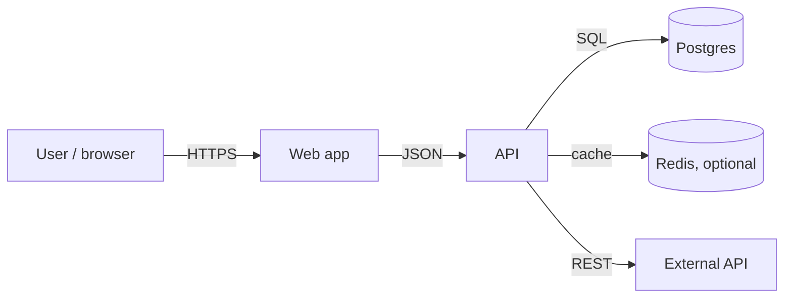
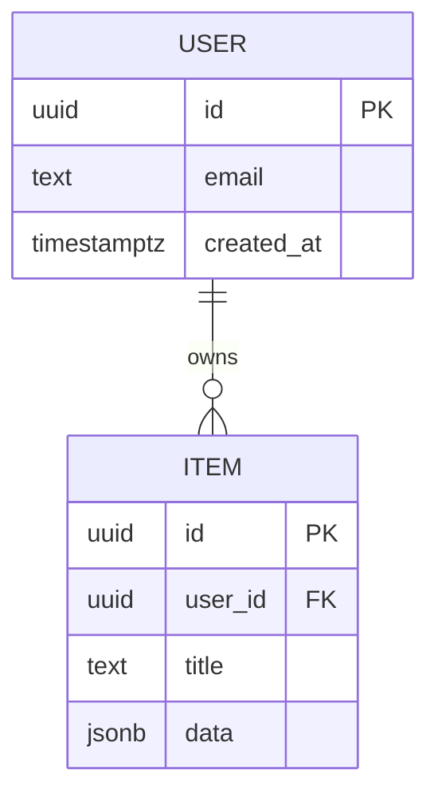

# Architecture

> Keep this current enough that a teammate can point at one box and say "that's mine".

## Runtime shape

Replace the diagram with the real one as soon as components exist.

## Components

| Component | Path | Owner | Responsibility |
|---|---|---|---|
| Web app | `src/app` | | UI, routing, client state |
| API | `src/server` | | Auth, validation, business logic |
| Shared lib | `src/lib` | | Pure functions, types, formatters |
| Database | `src/db` | | Schema, migrations, seed |

## Data model

<!-- Tables/collections, key fields, relations. A mermaid erDiagram beats prose. -->

## Boundaries and contracts

- Browser never talks to the database directly.
- All external calls go through one module per provider (`src/server/providers/*`) so they can be mocked.
- Types shared between client and server live in `src/lib/types.*`.

## Environments

| Env | URL | Data | Notes |
|---|---|---|---|
| Local | http://localhost:3000 | Docker Postgres, seeded | `make up && make dev` |
| Demo | | Seeded, reset before pitch | Never the only copy |

## Failure modes

<!-- What breaks first, and what the demo does when it does. Update after the first incident. -->
